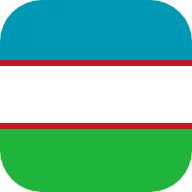

<div align="center">



# Uzbek Transliterator

**Oʻzbek · Özbek · Ўзбек · ئۉزبېک · Ozʙek**

Oʻzbek matnini besh yozuv orasida oʻgiruvchi · Convert Uzbek text between five scripts

[](https://github.com/otabekoff/uzbek-transliterator/actions/workflows/test.yml)
[](LICENSE)

**[Ochish / Open the converter →](https://otabekoff.github.io/uzbek-transliterator/)**

</div>

---

## Oʻzbekcha

Uzbek Transliterator: oʻzbek tilidagi matnni yozish jarayonida bir yozuvdan boshqasiga oʻgiradigan bepul vosita.
Matn brauzeringizda oʻgiriladi va hech qayerga yuborilmaydi. Sahifani ilova sifatida oʻrnatish mumkin,
bir marta ochilgach internetsiz ham ishlaydi.

| Yozuv | Yillar | Qayerdan / qayerga |
|---|---|---|
| **Lotin yozuvi** (1995): Oʻ Gʻ Sh Ch | 1995 – hozir | ⇄ |
| **Yangi lotin yozuvi** (2026): Ö Ğ Ş Ç | 2027-yil 22-apreldan | ⇄ |
| **Kirill yozuvi** | 1940 – hozir | ⇄ |
| **Arab yozuvi**, *Yangi imlo* | taxm. 1921–1928 | → faqat natija, tajriba |
| **Yanalif** («yangi alifbo») | 1929–1940 | → faqat natija, tajriba |

Interfeys yetti tilda: oʻzbekcha (lotin, yangi lotin, kirill, arab, yanalif), inglizcha va ruscha.

## English

Uzbek Transliterator converts Uzbek text between its writing systems as you type. Everything runs in your
browser and your text is never uploaded. It installs as an app and works offline after the first visit.

| Script | Years | Direction |
|---|---|---|
| **Latin** (*Lotin yozuvi*, 1995): Oʻ Gʻ Sh Ch | 1995 – today | from and to |
| **New Latin** (*Yangi lotin yozuvi*, 2026): Ö Ğ Ş Ç | from 22 April 2027 | from and to |
| **Cyrillic** (*Kirill yozuvi*) | 1940 – today | from and to |
| **Arabic script**, *Yangi imlo* (the Jadid reform) | c. 1921–1928 | to only, experimental |
| **Yanalif** (*Yañalif*, "new alphabet"), 1934 Uzbek version | 1929–1940 | to only, experimental |

## Interface languages

Every interface language is its own pre-rendered page, so search engines index each one with the right
`lang`, `dir`, title and description, and the pages link to each other with `hreflang`.

| Page | Interface | Opens with |
|---|---|---|
| [`/`](https://otabekoff.github.io/uzbek-transliterator/) | Oʻzbekcha, lotin | Latin → Cyrillic |
| [`/yangi-lotin/`](https://otabekoff.github.io/uzbek-transliterator/yangi-lotin/) | Özbekça, yangi lotin | Latin → new Latin |
| [`/kirill/`](https://otabekoff.github.io/uzbek-transliterator/kirill/) | Ўзбекча, кирилл | Cyrillic → Latin |
| [`/arab/`](https://otabekoff.github.io/uzbek-transliterator/arab/) | ئۉزبېکچە, right to left | Latin → Arabic |
| [`/yanalif/`](https://otabekoff.github.io/uzbek-transliterator/yanalif/) | Ozʙekca, yanalif | Latin → Yanalif |
| [`/en/`](https://otabekoff.github.io/uzbek-transliterator/en/) | English | Latin → Cyrillic |
| [`/ru/`](https://otabekoff.github.io/uzbek-transliterator/ru/) | Русский | Cyrillic → Latin |

The Uzbek interface is written once, in Latin ([`src/i18n/uz.mjs`](src/i18n/uz.mjs)); the build converts
it into the other four Uzbek scripts with the converter itself. English and Russian are written by hand.

## The five scripts

**Latin, 1995.** Adopted in 1993 and revised in 1995: the digraphs Oʻ Gʻ Sh Ch (and Ng) and the tutuq sign ʼ.
Cyrillic is converted with the official rules: `е` → `ye` at the start of a word and after a vowel,
`ц` → `ts` after a vowel and `s` elsewhere, `ъ` → `'`, `ь` is dropped.

**New Latin, 2026.** A law signed on 21 October 2026 (in force 22 April 2027) replaces Oʻ, Gʻ, Sh, Ch
with Ö, Ğ, Ş, Ç: 28 letters plus the tutuq sign ʼ (U+02BC). Ng is no longer a separate letter. Because
"sh" is now `ş`, the old `sʼh` becomes a plain `sh` (`Isʼhoq` → `Ishoq`). Latin ⇄ new Latin is a direct
letter swap, so nothing is lost either way.

**Cyrillic, 1940.** Still widely used. It is the hub for every other conversion, because it keeps the most
distinctions (о/ў, е/э, ц, ъ).

**Arabic script, Yangi imlo** *(experimental, output only)*. The reformed Arabic orthography of the
Jadids in the 1920s writes every vowel and adds letters for sounds Arabic lacks:
`а` ە, `о` ا, `у` ۇ, `ў` ۉ, `и` ى, `е/э` ې, `в` ۋ, `нг` ڭ, `ҳ` ھ, `ъ` ء.
A vowel at the start of a word, or after another vowel, gets the hamza seat ئ, and `, ? ;` become `، ؟ ؛`.
Uzbeks in Afghanistan still write in Arabic script, with somewhat different spelling.

**Yanalif, 1934–1940** *(experimental, output only)*. The unified Latin alphabet for the Turkic peoples of
the USSR. The Uzbek version was adopted at the 1929 Samarkand spelling conference and simplified in 1934
(Ө, Y and Ь removed, Ə replaced by A). This converter writes the 1934 version: `ч` c, `ж` ç, `ш` ş,
`й` j, `ғ` ƣ, `нг` ꞑ, lower-case `б` ʙ, and the Cyrillic `о` sound as a (`ё` → ja), `ў` as o.

## Examples

| Lotin | Yangi lotin | Кирилл | Arab | Yanalif |
|---|---|---|---|---|
| Oʻzbekiston | Özbekiston | Ўзбекистон | ئۉزبېکىستان | Ozʙekistan |
| choy, shahar | çoy, şahar | чой, шаҳар | چاي، شەھەر | caj, şahar |
| maʼno, Isʼhoq | maʼno, Ishoq | маъно, Исҳоқ | مەءنا، ئىسھاق | maʼna, Ishaq |
| yoz, yoʻl | yoz, yöl | ёз, йўл | ياز، يۉل | jaz, jol |
| tong, ketsa | tong, ketsa | тонг, кетса | تاڭ، کېتسە | taꞑ, ketsa |

> [!NOTE]
> Two parts are rules of thumb, not a dictionary: Latin `ts` (`ц` in loanwords, `тс` before an Uzbek suffix),
> and everything about the experimental Arabic and Yanalif output. If you find a wrong word, please
> [open an issue](https://github.com/otabekoff/uzbek-transliterator/issues) with it.

## Use it in your own code

[`src/scripts/translit.js`](src/scripts/translit.js) has no dependencies and no DOM access. Copy it
into your project. Script names: `latin`, `latin2026`, `cyrillic` (sources and targets), `arabic`,
`yanalif` (targets only).

```html
<script src="translit.js"></script>
<script>
  Translit.convert("O'zbekiston", 'latin', 'latin2026');  // "Özbekiston"
  Translit.convert('Тошкент', 'cyrillic', 'latin');       // "Toshkent"
  Translit.convert('Özbekiston', 'latin2026', 'arabic');  // "ئۉزبېکىستان"
</script>
```

```js
// Node.js
const { convert } = require('./translit.js');
```

## How the site is built

The site is static and hosted on GitHub Pages, so there is no server to render pages on request. Instead,
`npm run build` renders every page ahead of time, which gives search engines the same fully rendered HTML
that server-side rendering would:

- one page per interface language, with its own `lang`/`dir`, title, description, canonical URL,
  `hreflang` links, Open Graph tags and `WebApplication` structured data;
- `sitemap.xml` (with language alternates) and `robots.txt`;
- a web app manifest and a service worker that pre-caches every page and asset, so the app installs and
  works offline. Pages are network-first (updates show up straight away), assets are cache-first; the
  cache is versioned by a hash of the sources and old caches are removed.

The browser script only wires up the pre-rendered page. Bootstrap 6 (alpha) and the icons are kept in the
repo, so nothing loads from a CDN.

```text
src/                            everything written by hand
  scripts/translit.js           conversion between the five scripts
  scripts/main.js               page behaviour (ES module)
  styles/main.css               site styles and the flag-blue primary colour
  i18n/uz.mjs, en.mjs, ru.mjs   interface text (Uzbek is converted into its other four scripts)
  data.mjs                      alphabet table and sample text
  icons.svg                     Bootstrap Icons used on the page, inlined into every page
  sw.js                         service worker template
assets/                         static files, copied as they are
  images/                       favicon, app icons, flag
  vendor/bootstrap/             Bootstrap 6.0.0-alpha.1 (CSS and JS bundle)
build/
  build.mjs                     renders dist/: pages, manifest, service worker, sitemap, robots.txt
  page.mjs                      the page template
  serve.mjs                     local preview server
test/                           converter and build tests (node:test)
dist/                           build output (not committed); scripts and styles end up in dist/assets/
```

## Development

Needs Node.js 20 or newer; there are no dependencies to install.

```sh
npm start        # build, then serve dist/ on http://localhost:8080/
npm test         # converter tests, plus a full build checked page by page
npm run build    # build only (SITE_URL=https://example.com/ to change the public URL)
```

Opening the HTML files straight from disk does not work: ES modules and service workers need `http://`.

GitHub Actions runs the tests on every push and pull request, and deploys `dist/` to GitHub Pages on every
push to `main` (set Pages → Source to "GitHub Actions" in the repository settings).

## Contributing

Bug reports and pull requests are welcome. For a wrong conversion, include the input text, what you got,
and what you expected, and add a test case to `test/translit.test.js` with any fix. Interface text lives in
`src/i18n/`; a new key must be added to all three files (the build stops if one is missing).

## Sources

- New Latin alphabet law, 2026: [UzbekType](https://www.uzbektype.uz/en/blog/new-uzbek-alphabet-2026),
  [Gazeta.uz](https://www.gazeta.uz/en/2026/07/09/alphabet/), [Daryo](https://daryo.uz/en/2026/10/22/mirziyoyev-signs-law-revising-uzbekistans-latin-alphabet-with-textbook-rollout-from-2027/)
- Letter correspondences, Yangi imlo and Yanalif: [Wikipedia: Uzbek alphabet](https://en.wikipedia.org/wiki/Uzbek_alphabet),
  [Wikipedia: Yañalif](https://en.wikipedia.org/wiki/Ya%C3%B1alif)

## Credits

[Bootstrap](https://getbootstrap.com/) 6.0.0-alpha.1 and [Bootstrap Icons](https://icons.getbootstrap.com/) 1.13.2 (MIT).

## License

[MIT](LICENSE) © Otabek
