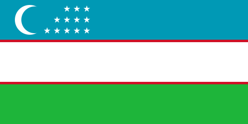

<div align="center">



# Uzbek Transliterator

**Lotin ↔ Kirill** · O'zbek matnini lotin va kirill alifbolari orasida o'giruvchi

[](https://github.com/otabekoff/uzbek-transliterator/actions/workflows/test.yml)
[](LICENSE)
[](https://otabekoff.github.io/uzbek-transliterator/)

**[Ochish / Open the converter →](https://otabekoff.github.io/uzbek-transliterator/)**

</div>

---

## O'zbekcha

Uzbek Transliterator: o'zbek tilidagi matnni **lotin yozuvidan kirillga** va **kirilldan lotinga** yozish
jarayonida o'giradigan bepul vosita. Hammasi brauzeringizda ishlaydi: matn hech qayerga yuborilmaydi,
server ham, ro'yxatdan o'tish ham kerak emas.

- `oʻ`, `gʻ` va tutuq belgisining barcha shakllarini tushunadi: `'` `’` `‘` `ʻ` `ʼ`
- `e` → `э` (so'z boshida va unlidan keyin), `ts` → `ц` / `тс`, `s'h` → `сҳ`
- Katta harflar to'g'ri saqlanadi: `Shahar` → `Шаҳар`, `SHAHAR` → `ШАҲАР`
- Yo'nalishni bitta tugma bilan almashtirish, nusxa olish, `.txt` faylni ochish (sudrab tashlash ham mumkin) va saqlash
- So'z va belgilar soni, alifbo jadvali va qoidalar qo'llanmasi
- Interfeys o'zbek va ingliz tillarida; yorug', qorong'i va avtomatik mavzu
- Telefon va planshetga moslashgan; matn keyingi safar ham saqlanib qoladi

## English

Uzbek Transliterator converts Uzbek text between the **Latin** and **Cyrillic** alphabets, in either
direction, as you type. It is a static page: everything runs in your browser and your text is never sent
anywhere.

- Handles every apostrophe form, `e`/`э`, `ts`/`ц`, `sʼh` and capitals (see the examples below)
- Swap direction in one click, copy the result, open a `.txt` file (or drop it on the page) and save the result
- Word and character counts, an alphabet table and a rules guide
- Interface in Uzbek and English; light, dark and automatic themes
- Works on phones and tablets; your last text is kept for next time

## Examples

| Lotin | Кирилл | Rule |
|---|---|---|
| `Oʻzbekiston` | `Ўзбекистон` | `oʻ` → `ў` (any apostrophe form) |
| `gʻoz`, `maʼno` | `ғоз`, `маъно` | `gʻ` → `ғ`, the apostrophe on its own → `ъ` |
| `erkin`, `aeroport` | `эркин`, `аэропорт` | `e` → `э` at the start of a word and after a vowel |
| `yoʻl`, `yer`, `poyezd` | `йўл`, `ер`, `поезд` | `y` + `oʻ` stays two letters; `ye` → `е` |
| `Isʼhoq` | `Исҳоқ` | `sʼh` is a separate `с` + `ҳ` |
| `ketsa`, `sifatsiz` | `кетса`, `сифатсиз` | `ts` before an Uzbek suffix → `тс` |
| `tsirk`, `stantsiya` | `цирк`, `станция` | `ts` elsewhere → `ц` |
| `SHAHAR`, `Shahar` | `ШАҲАР`, `Шаҳар` | ALL CAPS and Title case are kept |

Cyrillic → Latin follows the official 1995 rules: `е` → `ye` at the start of a word and after a vowel,
`ц` → `ts` after a vowel and `s` elsewhere, `ъ` → `'`, and `ь` is dropped.

> [!NOTE]
> The `ts` rule is a rule of thumb, not a dictionary, so a rare word can come out wrong. If you find one,
> please [open an issue](https://github.com/otabekoff/uzbek-transliterator/issues) with the word.

## Use it in your own code

[`assets/scripts/translit.js`](assets/scripts/translit.js) has no dependencies and no DOM access. Copy it
into your project.

In the browser it adds a global `Translit`:

```html
<script src="translit.js"></script>
<script>
  Translit.latinToCyrillic("O'zbekiston");  // "Ўзбекистон"
  Translit.cyrillicToLatin('Тошкент');      // "Toshkent"
</script>
```

In Node:

```js
const { latinToCyrillic, cyrillicToLatin } = require('./translit.js');
```

## Project structure

```text
index.html                    the page
assets/
  scripts/translit.js         conversion functions
  scripts/main.js             page behaviour (direction, copy, files, language, theme)
  scripts/bootstrap.bundle.min.js   Bootstrap 5.3.9 JS (dropdown, accordion, tooltips, toasts)
  styles/main.css             design tokens (flag colours) and site styles on top of Bootstrap
  styles/bootstrap.min.css    Bootstrap 5.3.9 CSS
  images/                     flag and favicon
test/translit.test.js         unit tests (node:test)
```

## Development

No build step and no dependencies. Open `index.html` directly or serve the folder:

```sh
npx serve .        # or: python -m http.server
```

Run the tests (Node 18 or newer):

```sh
npm test
```

GitHub Actions runs the tests on every push and pull request.

## Contributing

Bug reports and pull requests are welcome. For a wrong conversion, include the input text, what you got,
and what you expected. Please add a test case to `test/translit.test.js` with any fix.

## Credits

- [Bootstrap](https://getbootstrap.com/) 5.3.9 and [Bootstrap Icons](https://icons.getbootstrap.com/) 1.13.2 (MIT), kept in the repo so the page needs no CDN.

## License

[MIT](LICENSE) © Otabek
